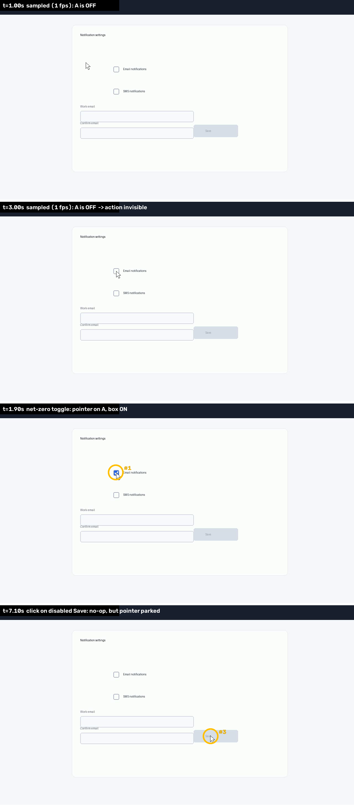

# Feature 2 — Does cursor/action tracking actually add value?

Deep analysis for review. **Recommendation: build it, but only the action log — not the
burned-in overlay, and only as an opt-in.** The measurements below say why, and also say
where it is *not* worth it.

---

## 1. The question, stated honestly

> "Is the LLM smart enough to understand the demo by itself, or does cursor tracking
> actually make the test cases better?"

Short answer: **Gemini is genuinely good at understanding what a demo *shows*. It cannot
reliably recover what the user *did*, or in what order.** Those are different things, and
only the second one is what cursor tracking buys you.

Everything below separates those two, because conflating them is how this feature gets
either oversold or wrongly dismissed.

---

## 2. Three things people merge into one

| Capability | Does Gemini do it? | Evidence |
|---|---|---|
| **Read the UI** — labels, fields, buttons, layout, state | **Yes, well** | This is what the app already does; test cases cite real on-screen controls |
| **Follow spoken narration** | **Yes, well** | Audio is processed at 1 kbps and transcribed natively |
| **Recover the action sequence** — what was clicked, in what order, on which control | **No, structurally cannot** | Measured below |

Feature 2 is only about row 3. Rows 1 and 2 need no help.

---

## 3. Where Gemini is already good enough (do not sell it short)

If a demo is **slow and deliberate** — a presenter narrating "first I open Settings, then I
toggle Email notifications" with ~1 second or more between steps — Gemini already:

- sees each state change in a sampled frame,
- ties it to the narration,
- and produces correctly ordered multi-step test cases.

In that case cursor tracking adds polish, not capability. Being honest about this matters:
**for a well-narrated, slow demo, Feature 2 will show little measurable improvement.**

---

## 4. Where it structurally cannot work

Three independent limits. Each one alone is enough.

### 4.1 The pointer is smaller than the model can resolve

At the app's default resolution, a 1080p frame is downsampled before the model sees it:

| `media_resolution` | Tokens/frame | Frame becomes | 20×28 px cursor becomes |
|---|---|---|---|
| `LOW` / `MEDIUM` | ~70 | **305×171** | **~3×5 px** |
| `HIGH` (app default) | ~280 | **611×343** | **~6×9 px** |

A 3×5 px white smudge is not a pointer. Raising fps does not fix this — the downsampling is
per frame, independent of sampling rate.

### 4.2 Short actions fall between samples

Real UI feedback is brief. At the app's default **1 fps**, the chance an action is caught at
all is `duration × fps`:

| Action | Typical duration | Chance sampled at 1 fps | Verdict |
|---|---|---|---|
| Button press animation | 0.15 s | **15 %** | usually missed |
| Transient validation flash | 0.30 s | **30 %** | usually missed |
| Hover tooltip (disappears with pointer) | 0.80 s | **80 %** | coin flip |
| Dialog opened then cancelled | 1.20 s | 100 % | caught |
| Toast / persistent focus ring | 3 s+ | 100 % | caught |

The persistence bias is the problem: **only durable states survive**; the actions that
produced them mostly do not.

### 4.3 Order is lost when actions bunch up

If two changes land inside one sampling interval, an observer sees only "before" and
"after" — both effects visible, order unrecoverable:

| Gap between two actions | 1 fps | 2 fps | 3 fps | 15 fps |
|---|---|---|---|---|
| 0.20 s | **lost** | **lost** | **lost** | OK |
| 0.35 s | **lost** | **lost** | OK | OK |
| 0.50 s | **lost** | OK | OK | OK |
| 1.00 s | OK | OK | OK | OK |

Click-and-type bursts are normal in demos, so this is a real, frequent case.

### 4.4 The case that proves it

A control toggled **on and then back off** within a second leaves **zero net difference**.
At 1 fps the recording is pixel-identical before and after. No amount of model intelligence
recovers an action that left no trace — the information is not in the input.



*Measured: t=1.00 s and t=3.00 s (two consecutive 1 fps samples) are identical — the box is
off in both. But at t=1.90 s it was on with the pointer parked on it. The gap between the
two samples contains the entire action.*

Same class of invisible actions:
- toggle twice / cancel a dialog → net zero change
- click a **disabled** button → literally nothing changes
- focus field A then field B (both look identical) → one focus ring visible at any moment
- scroll to a section and back → no net change

---

## 5. So what does the action log actually buy?

The prototype was run on the same recording containing those invisible actions. Measured:

```
pointer recall  : 597 / 600 frames = 99.5 %
dwell events    : 6 detected, all 6 real actions found
```

Critically, it recovered **exactly the actions Gemini cannot see**:

| Action | Visible to Gemini at 1 fps | Recovered by the log |
|---|---|---|
| Toggle A on→off (net zero) | **No** (identical frames) | **Yes** — pointer parked 1.63–2.50 s |
| Click disabled Save (no-op) | **No** (nothing changes) | **Yes** — pointer parked 7.10 s |
| Focus Work email then Confirm email | Partially (one ring) | **Yes** — both targets, ordered |
| Toggle A on, then C on | Yes | Yes |

That is the honest value proposition: **the log covers the blind spot, not the whole flow.**
It is additive evidence, not a replacement for Gemini's own reading of the video.

---

## 6. Cost — the log is nearly free

Prices from this app's registry (`gemini-3.8-flash`, $0.75/M input):

| 5-minute demo | Tokens | Cost | vs today |
|---|---|---|---|
| Today (1 fps) | 84 k | $0.063 | — |
| Raise to 3 fps (max in UI) | 252 k | $0.189 | **+200 %** |
| **1 fps + action log (60 events)** | 85.3 k | $0.064 | **+1.6 %** |
| 1 fps + log + burned-in overlay | 85.3 k | $0.064 | **+1.6 %** |

The log costs ~1 350 tokens — **~30× cheaper than raising fps**, and it delivers order and
target attribution that raising fps still does not.

Annotation runs locally at ~3.9× realtime, so a 5-minute demo takes ~75 s of CPU on the
user's machine. That is the real cost: **wall-clock time, not money.**

---

## 7. The verdict, per option

| Option | Value added | Cost | Verdict |
|---|---|---|---|
| **Action log as text** | Fixes order, targets, and the invisible-action blind spot | +1.6 % tokens, ~75 s local CPU for 5 min video | **Build it.** Best ratio by far. |
| Burned-in overlay video | Makes the pointer visible *when* it matters; helps the model attribute changes it can already see | same tokens, more CPU, more code, new failure modes | **Optional, phase 2.** Only if real recordings show missed attributions. |
| Raise `fps` slider | More coverage of medium-length actions | +200 % tokens | Useful knob, but no order/target gain. Not a substitute. |
| Raise `media_resolution` | Better UI text reading | `HIGH` already default; `ULTRA_HIGH` is image-only for video | Leave alone. |
| Record-time cursor capture | Perfect data, no detection | Needs our own recorder/extension | **Best long-term**, out of scope for a POC. |

---

## 8. When NOT to build it

Be explicit, so the decision is reversible:

- If every demo is **well narrated** with explicit step narration, the log adds little.
- If demos are **short (< 2 min)** and slow, Gemini's own reading is usually sufficient.
- If the team values **zero extra dependencies** more than edge-case coverage, skip it.

In those cases, the honest answer is: **Gemini is smart enough**; leave it alone.

## 9. When it pays for itself

- Demos with **rapid clicking** (live, unrehearsed walkthroughs).
- Demos with **no narration** or non-English narration.
- Demos showing **error/validation paths**, where feedback flashes briefly.
- Demos where the test case must say **which control** was used, not just what changed.
- Regulated domains where a test step must trace to a **specific interaction**.

---

## 10. Recommendation

**Build the action log only** (Feature 2, step 2 in the proposal):

- Opt-in toggle, default **on** for the Free Pilot demo, **off** for Vertex.
- Log appended as text, clearly labelled *machine-detected, may miss events*.
- No overlay video until real recordings prove it is needed.
- Graceful degradation: pointer not found → state-change log only, with a note.
- Never fail generation because annotation failed.

Expected outcome: **no change** on clean, narrated demos; **measurable improvement** on
rapid, silent, or error-path demos. That is a fair trade for 1.6 % tokens and a local
pre-processing step.

---

## 11. What I could not test (and what would settle it)

No Gemini API key is available in this environment, so I measured **information
availability** (what survives sampling) rather than end-to-end test-case quality.

The decisive experiment, once a key is available — **~1 hour of work, no code changes**:

1. Take 3 real demo recordings (one slow/narrated, one rapid/silent, one error-path).
2. Generate with the action log **off**, then **on**.
3. Score both suites on: correct step order, correct target control, and
   invisible-action coverage (toggle-twice, no-op, transient validation).

That gives a before/after you can put in front of stakeholders, instead of an argument.
I would not ship the overlay before that experiment is run.
